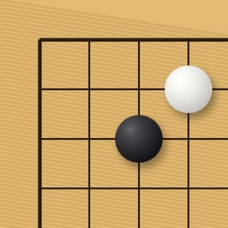

# NXGo

Go on the Nintendo Switch (homebrew), with [KataGo](https://github.com/lightvector/KataGo) running **natively on the console** as opponent and analysis engine. No PC needed.



## Features

- Play against KataGo (10 levels), two players on one console, or free analysis
- 9x9, 13x13 and 19x19 boards, handicap, Japanese or Chinese rules
- Analysis: win rate, score lead and best moves drawn on the board, optional territory estimate
- End of game: dead stones and territory estimated by KataGo, then move-by-move review with analysis
- Score graph in review: every move evaluated by the network in a few seconds, refined by the full analysis of the moves you look at; tap or drag it to jump to a move
- SGF save and load (`/switch/nxgo/sgf`, `/sgf`)
- Touch screen and controller everywhere
- English and French
- Online play on [OGS](https://online-go.com): your games in progress, automatic pairing (9x9 to 19x19, blitz to correspondence), clocks, dead-stone marking, and your game history: open any finished game for review with analysis and the score graph. Sign in with your username and password (exchanged for an OAuth token; the password is never stored)
- No cheating online: while an OGS game is in progress KataGo is completely off (no analysis, hints or score estimate, as OGS requires). Review with analysis is offered once the game is over
- Installable as a real title on the HOME menu (NSP), or as a classic `.nro`

## Performance

KataGo runs on the Switch CPU (Eigen backend, 3 threads). Measured on a Switch Lite at stock clock, launched as a game (full RAM):

| Network | 19x19 visits/s | Memory |
|---|---|---|
| b6c96 | ~32 | 50 MB |
| b10c128 | ~13 | 90 MB |
| b15c192 | ~4.5 | 227 MB |

9x9 and 13x13 use size-specific evaluators (about 3x faster on 9x9). Launch NXGo from a game (hold R) rather than from the Album: applet mode only has ~400 MB and less CPU time.

## Build

Requirements: [devkitPro](https://devkitpro.org) with devkitA64 and libnx.

```sh
git clone --recursive https://github.com/Rimsoo/NXGo.git
cd NXGo
tools/get_models.sh          # KataGo networks into romfs/models
make -C katago_port -j8      # KataGo + Eigen as libkatago.a
make -j8                     # nxgo.nro
```

Copy `nxgo.nro` to `/switch/nxgo/` on the SD card. Extra networks (`b6`, `b10`, `b15` as `.bin.gz` or `.txt.gz`) can be put in `/switch/nxgo/models/`.

### Installable title (NSP)

`make nsp` packs the build into `nxgo.nsp` (title ID `05004E58476F0000`, full RAM, no user picker). It needs [hacBrewPack](https://github.com/rlaphoenix/hacBrewPack) and the `prod.keys` dumped from your own console (Lockpick_RCM):

```sh
HACBREWPACK=/path/to/hacbrewpack KEYS=~/.switch/prod.keys make nsp
```

Install it with Sphaira, DBI or Tinfoil. Installed homebrew titles need sigpatches (e.g. sys-patch).

### OGS sign-in

NXGo signs in through a public OAuth2 application registered on online-go.com (password grant, no secret). Forks can use their own: `ogs_client_id=` in `/switch/nxgo/config.txt`, or `make OGS_CLIENT_ID=...` at build time.

## Layout

- `source/` the app (UI, game logic, KataGo bridge, OGS client in `ogs.cpp`, TLS + WebSocket in `net/`)
- `nsp/` NPDM description of the installable title
- `katago_port/` builds KataGo for Horizon with no source patch: a `ghc::filesystem` shim over `std::filesystem` and stubs for three missing POSIX calls
- `kgbench/` KataGo speed test on the console
- `tools/` dev helpers: `devrun.py` launches a `.nro` through hbmenu in game mode with [sys-botbase](https://github.com/olliz0r/sys-botbase) + nxlink (`SWITCH_IP` env var), `botbase.py` sends buttons, taps and screenshots
- `third_party/` KataGo and Eigen (submodules)

## Licenses

NXGo is GPL-3.0. KataGo is MIT, Eigen is MPL-2.0, stb is public domain. KataGo networks come from [katagotraining.org](https://katagotraining.org/networks/) and are not stored in this repository.
